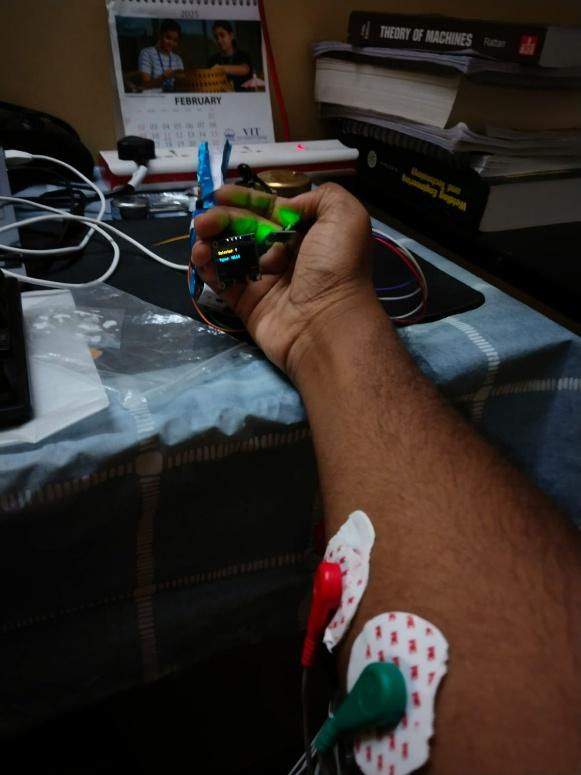
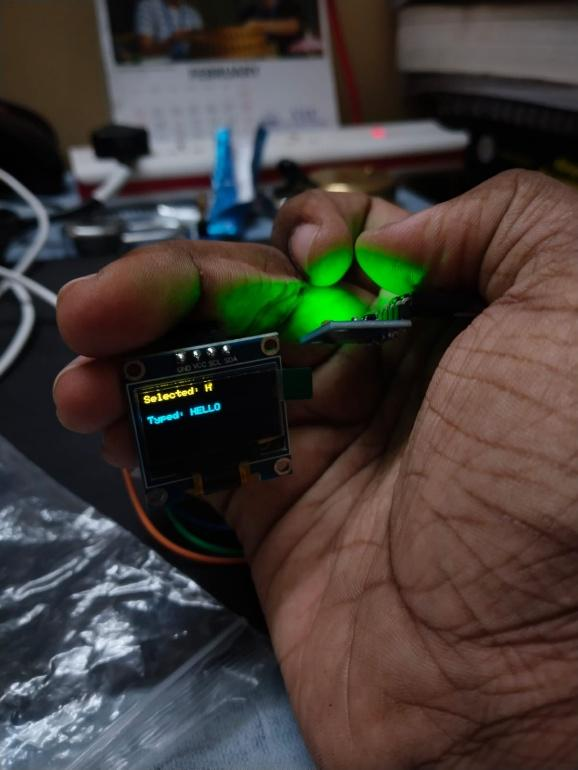
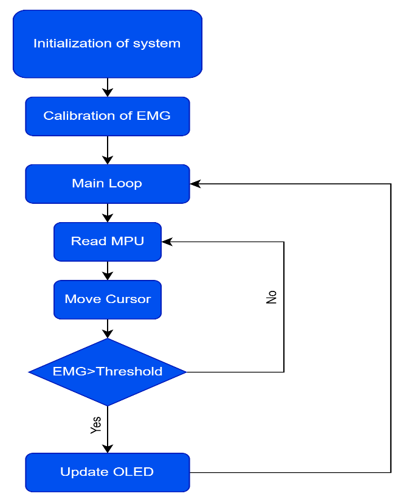

# Wearable EMG Keyboard Interface

A wearable, hands-free keyboard built on an ESP32. Tilting the wrist moves a highlight across an on-screen keyboard, and tensing a forearm muscle types the highlighted letter. A small OLED shows the highlighted key and the text typed so far.



## How it works

1. An **EMG sensor** with three electrode pads picks up the electrical signal of a forearm muscle.
2. An **MPU6050** motion sensor worn on the wrist measures tilt.
3. The **ESP32** reads both. Tilt moves the highlighted letter. A muscle signal above the threshold types it.
4. The **OLED display** shows the highlighted letter and the last 16 characters typed.



## Controls

| Action | Result |
|---|---|
| Tilt the wrist right | Highlight moves one key right |
| Tilt the wrist left | Highlight moves one key left |
| Tilt the wrist up | Highlight moves one row up |
| Tilt the wrist down | Highlight moves one row down |
| Tense the forearm muscle | The highlighted letter is typed |

The highlight wraps around at the edges of the keyboard. The layout has 3 rows of 10 keys:

```
Q W E R T Y U I O P
A S D F G H J K L ;
Z X C V B N M , . /
```

## EMG calibration

Muscle strength differs from person to person, so the typing threshold is set at start-up instead of being fixed.

1. After power-on the OLED shows "Relax your arm" for 2 seconds.
2. For the next **5 seconds**, flex the forearm muscle hard several times. The highest reading is recorded as the peak.
3. The threshold is set to **70% of the peak**. The OLED and Serial Monitor show both numbers.
4. If the peak is below 300, no muscle signal was seen. The sketch then uses a fixed threshold of 1000 and shows a warning on the OLED.

Example calibration values from the project report:

| User | Peak EMG reading | Threshold (70%) |
|---|---|---|
| Sample user 1 | 1500 | 1050 |
| Sample user 2 | 2100 | 1470 |
| Sample user 3 | 1850 | 1295 |

## Preventing accidental input

- **Smoothing:** tilt readings pass through a low-pass filter, so small hand tremors do not move the highlight.
- **Cooldowns:** the highlight can move at most once every 400 ms, and a letter can be typed at most once every 500 ms. Holding a flex does not type the same letter repeatedly.



## Hardware

| Part | Used for |
|---|---|
| ESP32 | Reads the sensors, runs the logic, drives the display |
| MPU6050 (6-axis motion sensor) | Wrist tilt |
| EMG sensor with 3 electrode pads | Muscle signal |
| I2C OLED display, 128 x 64 (SSD1306) | Selected key and typed text |
| External +9 V / -9 V supply | Powers the EMG sensor |
| USB cable | Powers the ESP32 and uploads the code |

## Wiring

**MPU6050** (I2C bus 1)

| MPU6050 pin | ESP32 pin |
|---|---|
| VCC | 3.3V |
| GND | GND |
| SDA | GPIO 21 |
| SCL | GPIO 22 |

**OLED** (separate I2C bus, address 0x3C)

| OLED pin | ESP32 pin |
|---|---|
| VCC | 3.3V |
| GND | GND |
| SDA | GPIO 25 |
| SCL | GPIO 26 |

**EMG sensor**

| EMG sensor pin | Connect to |
|---|---|
| Signal out | ESP32 GPIO 34 |
| +VS | +9 V from the external supply |
| -VS | -9 V from the external supply |
| GND | Ground of the external supply |

- Join the ground of the external supply to the ESP32 GND so the analog reading has a shared reference.
- The EMG output on GPIO 34 must stay between 0 V and 3.3 V, the input range of the ESP32.
- Electrode placement: two pads on the forearm muscle, and the third pad (the reference) on a neutral part of the body.

The OLED sits on its own I2C bus so that it does not interfere with the MPU6050.

## Setup

1. Install the ESP32 board package in Arduino IDE.
2. Install these libraries from the Library Manager: **Adafruit MPU6050**, **Adafruit Unified Sensor**, **Adafruit SSD1306**, **Adafruit GFX**.
3. Wire everything as shown above and attach the electrode pads.
4. Open `emg_keyboard/emg_keyboard.ino`, select your ESP32 board and port, and upload.
5. Open the Serial Monitor at 115200 baud to see live EMG values and the threshold.
6. When the OLED shows "Flex muscle now!", flex hard and repeatedly for 5 seconds.
7. Tilt the wrist to choose a letter and tense the muscle to type it.

## Settings

These values are at the top of `emg_keyboard.ino`.

| Setting | Default | What it does |
|---|---|---|
| `CALIBRATION_MS` | 5000 | Length of the calibration |
| `THRESHOLD_FRACTION` | 0.70 | Threshold as a fraction of the peak |
| `FALLBACK_THRESHOLD` | 1000 | Threshold used if calibration finds no signal |
| `MIN_VALID_PEAK` | 300 | Peaks below this count as "no signal" |
| `TILT_LIMIT` | 5.0 m/s² | How far the wrist must tilt to move the highlight |
| `TILT_SMOOTHING` | 0.3 | Lower values give smoother but slower tilt response |
| `MOVE_COOLDOWN_MS` | 400 | Minimum time between highlight moves |
| `SELECT_COOLDOWN_MS` | 500 | Minimum time between typed letters |

## Troubleshooting

- **Letters type by themselves:** restart to recalibrate and flex harder during the 5 seconds. Check that the electrode pads are firmly attached.
- **Nothing types:** in the Serial Monitor, compare the EMG value with the threshold while flexing. The EMG value must go above the threshold.
- **A tilt direction feels reversed:** turn the MPU6050 around, or swap the signs of the tilt checks in `loop()`.
- **"MPU6050 not found!" or "OLED not found!":** check the SDA and SCL wires and the 3.3V connection.

## Limitations

- The keyboard has no space or delete key.
- The OLED shows only the last 16 typed characters.
- Results depend on electrode placement, muscle fatigue and skin condition.
- A steady wrist is needed while navigating. Unintended tilts can move the highlight.
- The device is wired, with no Bluetooth or Wi-Fi link to a computer or phone yet.
- Typing accuracy and speed were not measured in formal trials.

## Folder structure

```
.
├── README.md
├── emg_keyboard/
│   └── emg_keyboard.ino       # ESP32 sketch
└── docs/
    ├── wearable_setup.jpg
    ├── oled_output.jpg
    └── flowchart.png
```
